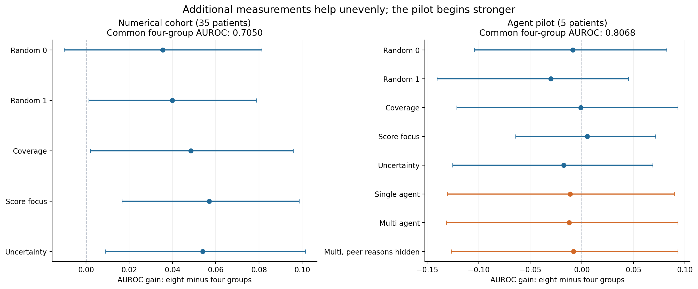
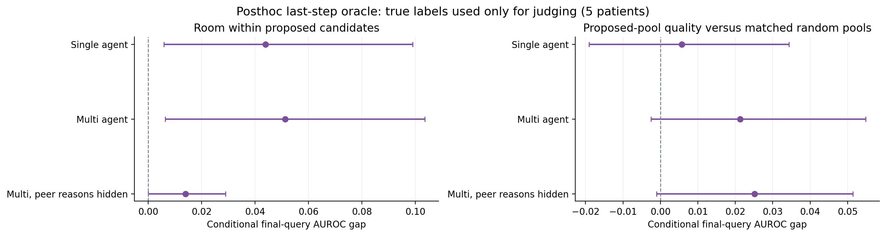

# Supplemental diagnostics for the physical multi-agent pilot

Additional physical response groups can improve the numerical benchmark, but the five-patient pilot started from a stronger four-group result. The candidate analysis finds label-privileged selection room within agent proposals; it does not establish that the proposals beat equally sized random pools or that a usable selector can find the better choice. No model API call or training fit was added.

## Four to eight measured response groups

On the 35-patient numerical cohort, score-focus rises from **0.705031** to **0.761978**, gain **+0.056947**, paired nominal95%interval **[0.016647981410789197, 0.09849324419851482]**. It improves25patients and worsens9, with one tie. This compares measurement budgets, not score-focus against random at the same budget.

The five-patient pilot already scores **0.806761** after the common four groups. Eight-group score-focus is **0.811940** (gain **+0.005178**), while multi is **0.794413** (gain **-0.012348**). All pilot four-to-eight intervals include zero. The pilot is not representative of the 35-patient mean starting accuracy; its five IDs were fixed before v11 outcomes, so this is a selection/generalization limitation rather than evidence of outcome-based cherry-picking.

| Population | Policy | AUROC4 | AUROC8 | Paired gain | Nominal95%interval |
|---|---|---:|---:|---:|---|
| full35 | Random 0 | 0.705031 | 0.740463 | +0.035433 | [-0.010099089430787422, 0.08140272467103712] |
| full35 | Random 1 | 0.705031 | 0.744937 | +0.039907 | [0.001371095933498466, 0.07868449238474014] |
| full35 | Coverage | 0.705031 | 0.753486 | +0.048455 | [0.002032000643778157, 0.09583452772362523] |
| full35 | Score focus | 0.705031 | 0.761978 | +0.056947 | [0.016647981410789197, 0.09849324419851482] |
| full35 | Uncertainty | 0.705031 | 0.758997 | +0.053966 | [0.009109636512085397, 0.10138522359498991] |
| pilot5 | Random 0 | 0.806761 | 0.797918 | -0.008844 | [-0.1043884295003578, 0.08241758241758239] |
| pilot5 | Random 1 | 0.806761 | 0.776599 | -0.030162 | [-0.1406345067362016, 0.04504342617550168] |
| pilot5 | Coverage | 0.806761 | 0.805799 | -0.000962 | [-0.12130284969268013, 0.09319982952058421] |
| pilot5 | Score focus | 0.806761 | 0.811940 | +0.005178 | [-0.06408279653402774, 0.07166470845716129] |
| pilot5 | Uncertainty | 0.806761 | 0.789102 | -0.017659 | [-0.12528248587570615, 0.06881033013108487] |
| pilot5 | Single agent | 0.806761 | 0.795542 | -0.011219 | [-0.13024823575671024, 0.08962840094915563] |
| pilot5 | Multi agent | 0.806761 | 0.794413 | -0.012348 | [-0.13115897888843195, 0.09316930449005918] |
| pilot5 | Multi, peer reasons hidden | 0.806761 | 0.798779 | -0.007983 | [-0.12679389952335257, 0.09316930449005918] |

## Is the final candidate pool useful?

Each actual seven-group prefix stays fixed. The judge tests the union of both three-position proposals and five seeded random pools of the same size. For each random pool, it takes its best true-label AUROC, then averages those five maxima. True labels are unavailable to the agents and are used only in this offline evaluator.

| Arm | Executed AUROC8 | Best proposed candidate | Mean matched-random oracle | Oracle minus executed | Proposal oracle minus random oracle |
|---|---:|---:|---:|---:|---:|
| Single agent | 0.795542 | 0.839543 | 0.833797 | +0.044001 | +0.005746 |
| Multi agent | 0.794413 | 0.845678 | 0.824389 | +0.051265 | +0.021290 |
| Multi, peer reasons hidden | 0.798779 | 0.812729 | 0.787536 | +0.013950 | +0.025192 |

For multi, the privileged best final candidate yields **0.845678**, versus executed **0.794413**: room **+0.051265** within the proposals. This gap is nonnegative by construction and is not a demonstrated improvement by a usable agent. Proposed-pool quality versus a matched random oracle is **+0.021290**, interval **[-0.002480081124148925, 0.05484449512751397]**, which includes zero.

A perfect judge of the last query does not define an achievable eight-step oracle trajectory: changing earlier decisions would change every later state and proposal. The result suggests candidate ranking is a worthwhile training target, while evidence that proposal generation itself is superior remains uncertain. Replacing just the last decision with the score-focus leader barely changes the multi mean (+0.000275 on the same actual seven-group prefixes), so a simple final-step geometric override is not a demonstrated fix.

## Verification and reporting limits

The supplement used **197 local HAT counterfactual evaluations**, zero API calls and zero new training fits. Independent audit reconstructed **190** patient/policy budget rows, **15** conditional-pool rows, every seeded pool and all paired bootstrap intervals. Original API attempts remain exactly120. Stored new neural predictions were not all re-inferred by this supplement audit; actual executed predictions match the separately re-inferred v16 results.

The bootstrap unit is the patient. Arms, electrodes and random-pool repeats are correlated observations, not new participants. All results are posthoc on a repeatedly inspected cohort; nominal intervals are not adjusted for the whole research search. Response groups are not single pulses or equal current/charge/time. SOZ discrimination does not demonstrate treatment efficacy.

For presentation, report the validated benchmark and negative collaboration result, then these two bottleneck findings. A next local experiment may learn relative candidate ranking using source-held-out development patients and compare separate specialists with an all-feature single model. It must not use these test-label oracle choices as deployed predictions or unreported tuning targets.
