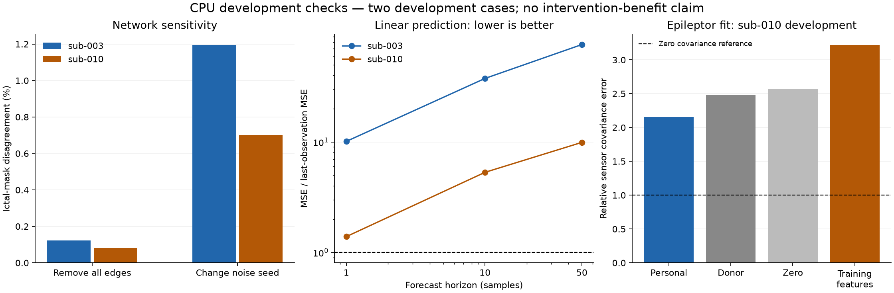

# CPU development v2: observation audit, network sensitivity and fitting

**Completed:** 35 new simulations, observation-only linear and Epileptor fits,
and independent replay. Sub-010's observation mapping is verified. Neither fit
is ready for intervention selection, and no personalization advantage has been
established.

This continues the agreed intervention-planning direction using only the existing
GCP CPUs. These are exploratory development results, not a frozen cohort test.
No held-out patients or additional intervention outcomes were examined.

## Observation mapping: one case passes, one remains inconsistent

The anatomical absolute-difference bipolar gain, electrode names, BrainVision
layout and exporter amplitude conversion reproduce **all three sub-010 sensor
recordings** from their released source arrays. Relative raw reconstruction error
is approximately **2.44e-8**, consistent with the stored float32 sensor precision.
The fitted scale is 1,000,000, matching conversion from the synthetic exporter's
volts to microvolts. This is not a biological amplitude calibration. Cropping is
checked against the timestamps in the source TSV, not chosen using outcomes.

For sub-003, the prior 18.60% raw reconstruction error persists. Signed-difference,
mean-contact and single-contact alternatives do not fix it. Per-channel affine
scaling leaves a 33.65% error on centered signals. An unconstrained linear map
learned from source/sensor data in the first half still has 21.42% relative error
on the second half; it is only a diagnostic and is never used by a planner.

The source NPZ and TSV representations also disagree at the same timestamps:
all 36 available sub-003 excerpt entries differ beyond eight-decimal rounding,
with maximum absolute difference 0.06637. For sub-010 all excerpts agree within
rounding. This establishes an inconsistency among sub-003 release representations;
it does not identify which file was generated incorrectly or fully explain the
sensor residual. Keep sub-003 for engineering controls and exclude it from
mechanistic fitting until that provenance issue is resolved.

Sub-010 run-01 has 113 channels and 162 regions. Its instantaneous gain matrix is
rank 113, with nonzero singular-value condition number about 203,366. Sub-003's
185-by-162 matrix is full column rank but has condition number about 27.6 million.
These are warnings against naive inversion, not proof that dynamics-informed
parameter inference is impossible. Source variances and hidden excitability are
not interchangeable, and regularization cannot create new observations.

## Network sensitivity at released parameters

Fifteen new untreated trajectories compare personal, donor, permuted and absent
connectivity, using paired seeds. They retain the original kernel, intact
normalization and development detector. A changed seed is a separate sensitivity
comparison, not another patient.

| Development case | Removing all edges: mask disagreement, seed 301 | Removing all edges: seed 302 | Changing personal-network seed |
|---|---:|---:|---:|
| sub-003 | 0.1633% | 0.0843% | 1.1947% |
| sub-010 | 0.0457% | 0.1183% | 0.7022% |

In both cases, the paired zero-connectivity perturbation is smaller than the
observed change between these two seeds. Both cases retain the same numbers of
active regions under all tested network replacements: 20 and 8, respectively.
This is a small development comparison, not a statistical equivalence result.

The slow coupling contribution's norm relative to the intrinsic slow RHS,
evaluated on saved temporally averaged states, is approximately 3.84e-6 for
sub-003 and 1.25e-6 for sub-010. It is a diagnostic on averaged states, not an
exact decomposition of the stochastic integration error. On sub-003, even
synthetic 10x, 100x and 1000x coupling stress cases retain 20 active regions;
the 1000x case changes 0.923% of the mask. These multipliers are sensitivity
conditions, not corrections to the release or calibrated biological values.

The released settings therefore remain a weak test of benefits from *network*
personalization. A larger intervention search would not resolve this limitation.

## Observation-only linear forecasting baseline

A new `PlannerObservation` contains only anatomy, gain and sensor recordings.
Unlike the legacy evaluator diagnostic object, it contains no source arrays or
generating parameters. The loader works without any evaluator assets present.

The first fit is a deliberately simple linear model: persistence plus a graph
Laplacian projected through the anatomical gain. Fit the first 60% of each run-01
recording; select regularization on the next 20%; score the final 20%, with a
50-sample embargo before each later block. Compare personal, donor, permuted and
zero networks, alongside last-observation and training-mean baselines. Forecasts
use the observation at their origin and no subsequent observations.

| Case | Personal MSE at 10 samples | Last-observation MSE | Personal MSE / last-observation MSE |
|---|---:|---:|---:|
| sub-003 | 0.40398 | 0.01075 | 37.58 |
| sub-010 | 0.59369 | 0.11183 | 5.31 |

MSE is normalized by training variance; horizons are samples, not biological
milliseconds. The personal model loses to last-observation persistence at all
three tested horizons (1, 10 and 50 samples). In sub-010 the fitted coupling
coefficient effectively vanishes for all networks. The poor result is preserved;
this baseline is not promoted into an intervention planner. A temporal block
from a nonstationary seizure is a demanding distribution shift, and these
development blocks do not constitute independent recordings or patients.

## Bounded observation-only Epileptor fit

The next fit uses only the verified sub-010 run-01 anatomy and first 60% of its
sensors. A process-level file-access guard rejects generator-parameter and source
trajectory paths. Priors are explicitly documented and informed by public author
code and earlier development; this is not a blinded investigator study.

Infer nonnegative regional variances from an approximate independent-source
covariance model, then match them to a small independent-node Epileptor library.
Four global r/slope candidates are evaluated with each of personal, donor and
zero connectivity under identical candidate budgets. Selection uses only
training sensor covariance error. Fresh seeds evaluate selected fits against
the later development block. This approximate initializer ignores source
correlations and timing, and is not Bayesian inference or a full posterior.

All three network fits selected the same library-derived x0 values and global
candidate (r=0.00035, slope=0.2). Independent-source covariance inversion already
leaves 54.62% training error; 12 inferred regional variances exceed the library's
range. Selected full-model training covariance errors are 58.78%, 60.89% and
59.16% for personal, donor and zero networks respectively.

| Fit | Later-block covariance relative error, seed 501 | Seed 502 | x0 mean absolute error |
|---|---:|---:|---:|
| Personal network | 2.330 | 1.984 | 0.2105 |
| Donor network | 2.385 | 2.589 | 0.2105 |
| Zero connectivity | 2.274 | 2.873 | 0.2105 |

The constant x0=-2.7 prior has MAE 0.2444, so this fit modestly improves that
particular parameter-recovery baseline. This does not establish a personalization
advantage: all three networks yield identical recovered x0 values. Reusing the
training covariance has later-block error 3.219, whereas an uninformative zero
covariance has relative error exactly 1. All fitted later-block errors exceed 1.
The recorded covariance norm falls from 1187.75 in training to 342.21 in the later
block, exposing the limitations of stationary, phase-unconditioned fitting.

A separately versioned exploratory check compares the same saved simulated
signals against runs 02 and 03 on all 113 shared channels, without refitting or
additional simulations. Personal-network errors are 1.326/1.182 on run 02 and
1.094/1.022 on run 03. They improve on reusing training covariance (1.727 and
1.157), but still exceed the zero-covariance reference. The evaluator finds four
x0 regions differ from run 01 in each additional run, with other model parameters
also changing. These are different conditions within one development patient,
not repeated observations of an identical latent model or independent patients.
The added check was planned after training results and the first later-block
evaluation rows were seen; it is explicitly exploratory.

**Decision:** retain these failed/limited fits as baselines and do not use them
to select interventions. The next fitting experiment should model seizure phase,
onset/offset or time-varying envelopes, and test whether a restricted set of
parameters is identifiable under the available electrode coverage. Do not tune
coupling merely to manufacture a personalization advantage.

## Reproducibility, limits and next work

All simulations, numerical tests, replay and scientific plotting run in
`/home/devstar3022/anya-intervention-research` on `scienceclaw-gcp`, with one
worker/thread at nice priority 10. Other jobs remain untouched. The shared
development wall cap is 3,600 seconds, with a 48-call ceiling and 64 MiB new-data
cap. The run completed 15 network-control trajectories, two 44-node independent
library simulations, 12 full-network fit candidates and six fresh-seed evaluations
(35 calls total). Simulation stages took 311.61 + 232.31 + 113.58 = 657.51 seconds,
about 11 minutes including their stage overhead. Elapsed time from the first
audit to the initial figure/resource report was 1,107.70 seconds (18.46 minutes).
Raw v2 output occupies about 258 MiB. New selected assets total 11,808,858 bytes;
cumulative acquired assets total
40,520,331 bytes, including the first pilot's reference images.

The source records are `manifests/development-v2.json`, `forecast-v2.json` and
`epileptor-fit-v2.json`; their implementation commits are d6ca090/d4a713e,
5182533 and c53c9d8. The initial pilot remains immutable. No IDEAS clinical-table
download was retried, and no GPU or new cloud resource was provisioned.

Nine invariant tests passed on GCP. Independent replay reproduced all 15 network
burdens, 24 forecast errors, and 18 fit/evaluation feature comparisons, and checked
the recorded fit input paths for forbidden source/parameter access. This verifies
calculations, not the model's biological validity. No active experiment remains.

Scientific gates remain: credible dynamics/feature prediction from observations;
informative network effects; verified physical intervention costs; established
virtual-resection comparators; and a formal freeze before the 24 reserved
patients. Historical outcome prediction remains a separate, unstarted study.

Machine-readable reports: `development-v2-source-audit.json`,
`development-v2-network.json`, `development-v2-forecast.json`,
`development-v2-replay.json`, `development-v2-epileptor-fit.json`,
`development-v2-epileptor-evaluation.json`, `development-v2-cross-recording.json`,
`development-v2-fit-replay.json` and `development-v2-resources.json`.

Upstream references: [VEC paper](https://journals.plos.org/ploscompbiol/article?id=10.1371/journal.pcbi.1012911),
[generation code at inspected revision](https://github.com/BalanceKey/virtual_epilepsy_patient_cohort/blob/a99c88354015f4c961d49a92c076ed0b675c740b/src/virtual_epileptic_seeg_ret_patient.py),
[bipolar gain convention](https://github.com/BalanceKey/virtual_epilepsy_patient_cohort/blob/a99c88354015f4c961d49a92c076ed0b675c740b/src/utils_functions/vep_prepare_ret.py).
