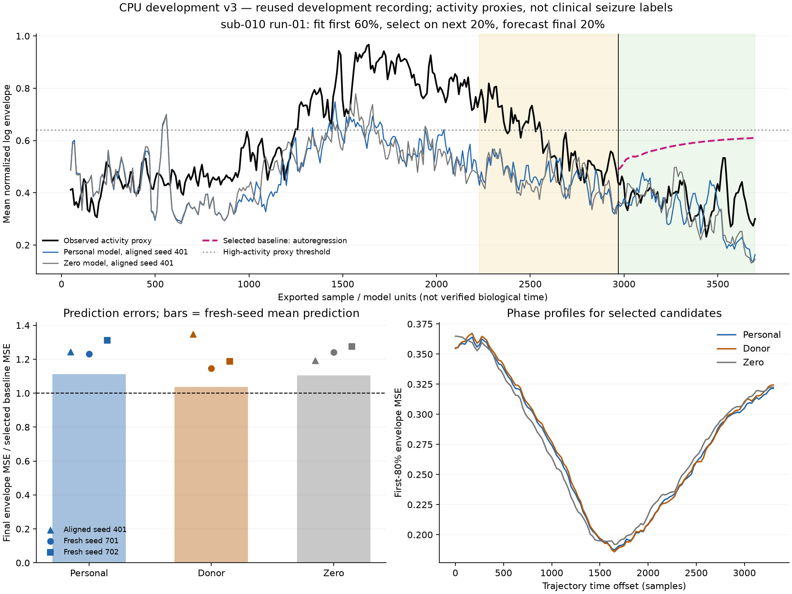

# CPU development v3: temporal alignment is insufficient

Completed 2026-11-01 on the existing `scienceclaw-gcp` CPUs. **The personalized
model still fails the observation-prediction screen, and personalization adds no
clear value over a disconnected network.** This is an exploratory diagnostic on
one previously studied development recording, not an intervention result.

The work remains aligned with the primary research direction: compare treatment
planning beyond SOZ localization under equal observations and action costs.
Predicting untreated activity is a prerequisite for trusting a model's predicted
response to resection. These failed fits were not used to choose interventions.
The 24 reserved patients remain untouched.

## Question and bounded design

V2 matched stationary covariance and failed to predict later activity. V3 asks
whether a global time alignment of those same fitted trajectories is sufficient
to improve prediction. The [manifest](../manifests/development-v3.json) and fitting
code were committed and pushed as `8d823e5` before new scores were computed.
Replay and plot code were added in `66deed0` without changing the fitting design.

Inputs were sub-010 clinicalhypothesis run-01: 3,700 exported samples and 113
channels, with the source/sensor mapping verified in v2. Fitting reused four
observation-only Epileptor candidates per network from v2. Their parameters had
been initialized from the first 60% of this recording; no released generator
parameters or source trajectories were opened in v3. Existing v2 results and
raw arrays were preserved.

The new feature is the log of one plus causal 50-sample channel variance divided
by a training-derived channel scale, sampled every 10 samples. This is an
activity-envelope proxy. Physical time remains unverified model/sample units.
The method differs from the high-pass/sliding-power/log/smoothing preprocessing
described in the [BVEP methods paper](https://journals.plos.org/ploscompbiol/article?id=10.1371/journal.pcbi.1009129).
V3 is neither a BVEP replication nor a clinically calibrated seizure detector.

For each network's four existing candidates, a single global offset was selected
on the first 60% from 133 offsets, 0–3,300 samples in steps of 25. Validation on
the next 20% selected the candidate. Its offset alone was then refitted on the
first 80%, and the remaining block was forecast without observation updates.
The first 50 samples after each boundary were excluded from scoring so target
windows did not overlap the preceding block's raw samples. There were 218
training feature points, 292 prefix points and 70 scored points in each later
block. Adjacent feature windows overlap; those points are not independent trials.

Persistence, prefix mean, zero envelope, damped trend and pooled autoregression
used the same observation boundary. Validation selected an autoregression with
10 lags and ridge 0.001; it remained stable after refitting the prefix, without
the specified persistence fallback. All choices were saved before final scoring.
Two new simulations per selected network, seeds 701 and 702, tested sensitivity
to noise. Each received the same prefix-only offset search. No seed was selected
or discarded, and coupling was not changed.

## Prediction results

Lower mean squared channel-envelope error is better. Ratios use the baseline
selected on validation, not a baseline selected after inspecting the final block.

| Forecast | Final MSE | Ratio to selected baseline |
|---|---:|---:|
| Selected autoregression | 0.138527 | 1.000 |
| Persistence | 0.141903 | 1.024 |
| Prefix mean | 0.160695 | 1.160 |
| Zero envelope | 0.250354 | 1.807 |
| Damped trend | 0.264286 | 1.908 |
| Personal, aligned seed 401 | 0.172213 | 1.243 |
| Personal, fresh seed 701 | 0.170708 | 1.232 |
| Personal, fresh seed 702 | 0.181760 | 1.312 |
| Personal, mean of two fresh predictions | 0.154061 | 1.112 |
| Donor, mean of two fresh predictions | 0.143529 | 1.036 |
| Zero network, mean of two fresh predictions | 0.152915 | 1.104 |

Both fresh personal trajectories lose to the simple autoregressive baseline.
Averaging them reduces error but still leaves 11.2% more error than that
baseline. The personal-to-zero-network ratio for mean predictions is 1.00749;
removing all edges gives essentially the same result in this diagnostic.
The predefined prediction and network screens both fail. These are descriptive
results from one recording, with no patient-level significance or confidence claim.

Autoregression's MSE advantage over persistence does not hold for MAE:
persistence MAE is 0.265738, autoregression 0.317196, and the personal mean
prediction 0.294478. The primary MSE endpoint was specified before the run;
there is no claim that the selected baseline wins on every measure.

The channel average in the figure can look reasonably aligned while individual
channel errors remain large. The primary score retains all channels rather than
judging success from that averaged trace.

## Timing and identifiability limits

All networks selected candidate 0: r=0.00015, slope=0, with their existing
covariance-derived x0 assignments. The aligned reference trajectories all selected
offset 1,650. For the personal reference model, offsets 1,500–1,825 were within
5% of the minimum prefix loss. Fresh personal seeds selected offsets 1,675 and
1,625, with similarly broad near-optimal ranges. These profiles describe weak
timing resolution in this finite search, not posterior intervals or proof of
parameter identifiability. V3 did not refit regional excitability or infer a
distribution over hidden states.

**The final scored block contains no high-activity episode under the frozen
proxy threshold.** Zero event mismatch for most methods therefore cannot be
interpreted as accurate onset/offset prediction. The final block measures later
activity evolution only; onset/offset generalization remains untested. Candidate
selection used validation activity, so its transitions cannot be repurposed as
an untouched test. This limitation is retained rather than changing thresholds
or partitions after inspecting the result.

The whole recording, including its final block, had already been inspected in
v2. This is reused development evidence. More noise seeds do not create new
patients, and phase alignment of fixed stochastic paths is not a complete
mechanistic inversion or a therapeutic model validation.

## Verification, provenance and resources

- **12 scientific invariant tests passed** on GCP in 1.77 seconds, including
  causal-window agreement, future-data exclusion, known-shift recovery,
  permutation behavior, recursive prediction and episode censoring.
- Independent replay used direct window variances without importing the new
  temporal implementation. It reproduced 12 candidate profiles, six fresh-seed
  profiles, baseline predictions and all 17 final MSE/MAE/mismatch rows, and
  verified the reused and new array hashes. Replay took 4.26 seconds.
- Six new full-horizon simulations took part in an evaluation stage lasting
  113.91 seconds. Total fitting/evaluation/replay compute was 119.13 seconds;
  experiment start through the aggregate report figure was 145.22 seconds.
  The 60-minute cap was not approached. Tests and code preparation preceded
  that experiment timer.
- One worker, one numerical thread, nice 10; the running process was observed
  at approximately one CPU core. No GPU, new resources or dataset downloads.
  No other job was altered. All scientific calculations, tests and plotting
  ran on GCP. Local work was editing, provenance, Git and visual review.
- Raw arrays remain in `/home/devstar3022/anya-intervention-research/outputs/development-v3`.
  This branch stores only compact summaries and an aggregate figure.

Evidence: [selection and phase profiles](development-v3/selection.json),
[all evaluation rows](development-v3/evaluation.json),
[independent replay](development-v3/replay.json),
[resource accounting](development-v3/resources.json). Source and data/artifact
hashes are included in the summaries. The original acquisition manifest and
patient split are unchanged.

## Consequence for the next stage

Do not expand intervention search using these fitted parameters. A timing shift
alone does not resolve the observation-prediction problem. Further fitting needs
to address regional activity amplitudes and temporal evolution jointly, with
explicit identifiability checks and event-containing validation recordings or
windows specified before new evaluation. Preserve the autoregressive and
persistence baselines; do not declare a detector successful on an event-free tail.

Network value remains a separate unresolved gate. Audit an established
propagation/virtual-resection model and its coupling conventions before selecting
a scientifically justified comparison regime; do not increase coupling merely
to obtain personalization gains. The primary endpoint remains equal-information
intervention benefit, with physical cost/time limitations resolved or explicitly
restricted before the reserved cohort is used.
