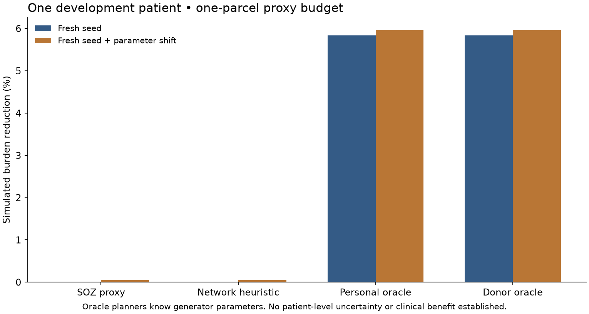

# GCP development pilot: no demonstrated personalization advantage

The bounded pilot completed on the existing GCP host. It does **not** establish
that patient-specific modeling improves intervention choice beyond SOZ targeting.
Both known-parameter planners selected the same parcel, and their apparent gain
came from removing active tissue rather than reducing activity in surviving tissue.
The equal-information primary question remains open.

## What ran

One intervention subject, VEC sub-003, already designated development; sub-010
provided only a donor connectome. Six candidate whole-parcel resections shared an
**exactly one-parcel count budget**, not matched tissue volume. Source code and the
development manifest were committed in `8d24247` before intervention simulations.
The 24 reserved evaluation patients remain untouched.

The SOZ comparator was an exploratory simulated-SEEG onset proxy, not a verified
clinical SOZ annotation. The simple numerical heuristic weighted that proxy by
outgoing structural strength. Both selected zero-based atlas index 122. Personal
and donor-network planners were explicitly given hidden generating parameters;
both selected index 126. Each model planner used six candidate simulations.
They were fixed before fresh-scenario evaluation. This information asymmetry
prevents interpreting the comparison as the primary estimand.

| Policy | Fresh seed: burden reduction | New seed + parameter perturbation | Cost |
|---|---:|---:|---:|
| SOZ proxy | 0.000% | 0.052% | 1 parcel |
| Network heuristic | 0.000% | 0.052% | 1 parcel |
| Personal oracle | 5.840% | 5.964% | 1 parcel |
| Donor oracle | 5.840% | 5.964% | 1 parcel |

The selected oracle action was the best of these six candidates in both
scenarios (finite-set regret zero). Personal minus donor selected-action benefit
was exactly zero. These are two scenarios for **one patient**, not a cohort or
independent replication. No patient-level confidence interval or significance
test is warranted. Negative candidate results are preserved: index 121 increased
burden in both scenarios; index 147 increased it in the perturbed scenario.

## Mechanistic control and reconstruction findings

At seed 201, untreated burden was 62,707 node-model-time units. Removing index 126
reduced it by 3,662. Its own untreated activity accounted for 3,770 units, while
surviving tissue activity **increased by 108**. Thus the observed gain does not
demonstrate propagation suppression. With all coupling removed, untreated burden
was 62,162; analytically removing index 126 still reduced it by 6.116%. The coupled
and zero-coupling ictal masks differed on 0.289% of post-transient node-time samples.
This development setting provides weak evidence about the value of the network.

No detected activity occurred outside the x0 > -2.1 susceptibility partition.
This partition includes potentially propagating regions and is not an onset/EZ
label. It cannot establish absence of propagation. Raw diagnostic field names
that implied onset/non-onset were corrected in the exported summary; their exact
threshold and original meaning are recorded in PROTOCOL.md.

The untreated trajectory repeated bit-for-bit with the same seed. Its regional
source standard-deviation pattern correlated 0.99948 with the released source
recording. This is a spatial amplitude check, **not** a successful time-course
reconstruction, withheld-recording prediction or biological validation.

Atlas order is verified: 162 labels match the connectome and forward-matrix
columns. The 185 bipolar sensor channel names can be mapped. However, the source
projection required a 100-sample crop and retained 18.60% relative RMS error after
one fitted scale. Channel correlations ranged 0.578–0.99957 (median 0.93925), with
151/185 below 0.99. The favorable best-channel correlation alone was misleading.
The released source/gain/SEEG relationship therefore remains insufficiently
verified for realistic parameter fitting. The SOZ proxy picked a parcel with no
baseline activity under the current detector; localization quality is a major
confound, not evidence for a better network planner.

Parcel volumes exist. Inspected pipeline code computes label counts times voxel
volume, but the release's exact pipeline revision and NIfTI header units remain
unverified. We did not relabel parcel count as removed tissue volume. Model time
and synthetic signal amplitude likewise retain their explicitly unverified
physical interpretation. Original noise seed and correlation-time metadata were
not supplied in the parameter TSV; ntau=1 follows the inspected generation code.

## Validation, failures and resources

Five scientific-invariant tests passed on GCP in 17.64 seconds: directed coupling
and intact normalization, null/resection behavior, paired noise/repeatability,
permutation and parameter boundaries, burden accounting, and numerical agreement
with TVB's stochastic Heun calculation (several invariants share a test).
All 26 pilot trajectories' file hashes, primary burdens, two sensitivity burdens
and selected-policy reductions were independently replayed using cumulative sums.

The first replay failed on sensitivity results: their original smoothing used
SciPy's default reflected boundary, while the primary metric explicitly used a
nearest boundary. The replay was corrected to match those original definitions;
all counts then agreed exactly. The original failure log and results are retained.
A formal protocol must standardize boundary behavior. No failed trajectory or
unfavorable result was removed. There were no simulator failures in the 26-call
pilot. The custom kernel's known defaults were cross-checked against TVB 2.10.0;
this is not asserted to be VEC's original unreleased software environment.

- Main pilot: 26 simulations, 631.42 seconds (10.52 minutes).
- Untreated baseline: 40.60 seconds; repeat/zero-coupling controls: 58.45 seconds.
- Total full-length calls: 29. About 12.2 minutes of simulation/control runtime;
  14.54 minutes elapsed from the initial baseline to completed controls.
- One GCP process/thread, nice priority 10; sampled RSS 246,517,760 bytes
  (235 MiB), not a measured peak. Existing GCP jobs were untouched.
- Selected dataset assets: 28,711,473 bytes, plus compact listing metadata;
  far below 2 GiB. Three unnecessary reference PNG downloads are included in that
  count and preserved in the acquisition log. GCP received only non-image assets.
- Environments, arrays and original clinical/simulated assets remain outside Git.
  Package versions, source hashes, input hashes and commands are committed.

The local machine was used for editing, metadata inspection, Git and reporting.
All simulations, numerical tests and independent metric replay ran on GCP.

## Feasibility decision and next work

A naive repeat of 26 calls across 24 subjects at the measured 23–40 seconds per
call would cost approximately 4–7 CPU-hours, excluding fitting and controls.
Two workers could roughly halve elapsed time when the existing host has capacity.
Thus compute is not the present blocker. Scientific prerequisites are.

Do not run the reserved cohort yet. First resolve the released forward-model
relationship and volume/time conventions; build a planner fitted only to allowed
pretreatment recordings; validate dynamics on withheld observations; establish an
informative network/propagation regime; and finish matched physical cost and
feasibility rules. Use development cases for these decisions and freeze a new
protocol before held-out intervention outcomes. A practical next development
allocation is one GCP worker for up to 60 minutes on the same two reserved
subjects, within a separately recorded run manifest, without acquiring test data.
See [next-stage gates](next-stage-gates.md).

IDEAS remains a separate retrospective objective. Published resources suggest
an imaging-based outcome study is plausible, but the clinical-table download was
denied. No matched cohort or 12-month endpoint was fabricated. Exact eligibility
requires authorized clinical metadata/dictionary access, processed-connectome and
resection inventories, and subject-level joins. No SEEG/SOZ availability is assumed.

Machine-readable evidence: [pilot summary](pilot-v1-summary.json),
[baseline](baseline-sub003-summary.json), [resource sample](resource-observation.json),
[initial replay failure](replay-initial-failure.log), [commands](commands.md), and
[feasibility/source audit](2026-11-01-feasibility.md).
